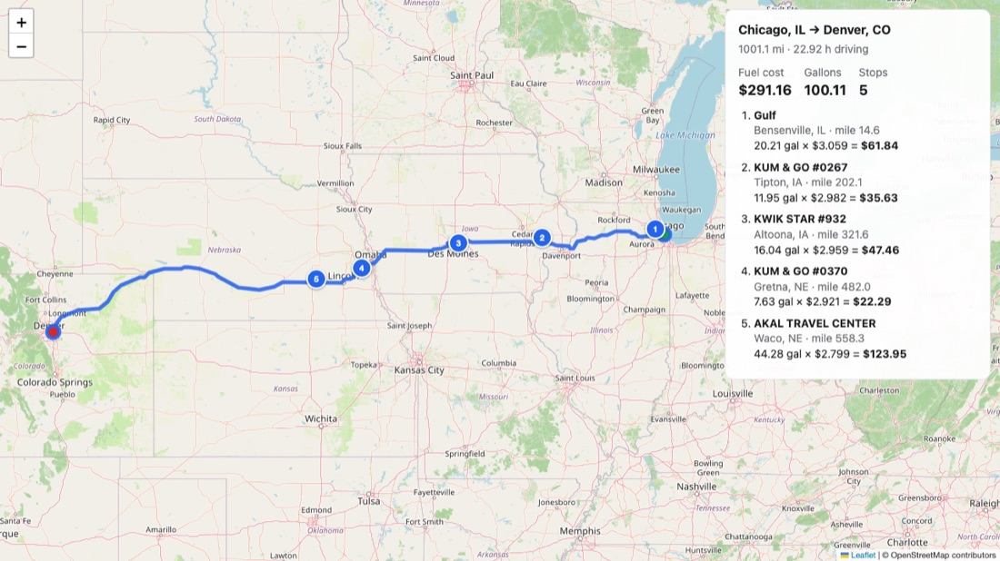

# Fuel Route API

A Django 6.1 API that takes a start and a finish location in the USA. It returns:
- the driving route, as GeoJSON and as a ready-made map page;
- the cheapest places to refuel along the route;
- the total fuel cost.

The vehicle has a 500-mile range, does 10 MPG and **starts with an empty tank**. Fuel prices come from the provided OPIS truck-stop file.

```
GET /api/v1/route/?start=Chicago, IL&finish=Denver, CO
→ 1,001 mi · 5 fuel stops · 100.1 gal · $291.16 · 1 routing call (0 on repeat)
```



## Quick start

Requires Python 3.12+. [uv](https://docs.astral.sh/uv/) is recommended; plain `pip` works too.

```bash
cp .env.example .env              # then add a free OpenRouteService key (see below)
uv sync                           # or: python -m venv .venv && .venv/bin/pip install -r requirements.txt
uv run python manage.py migrate
uv run python manage.py import_stations --offline   # loads 6,626 geocoded stations in under 1 s, no network
uv run python manage.py runserver
```

Open http://127.0.0.1:8000/ for an example map, or http://127.0.0.1:8000/api/docs/ for interactive Swagger docs.

**API key:** sign up free at https://openrouteservice.org/dev/#/signup and put the key in `.env` as `ORS_API_KEY=...`. `.env` is git-ignored. Without a key, the app still starts: routes already stored locally keep working, and new routes return a clear 503.

## Using the API

| Endpoint | Purpose |
|---|---|
| `GET /api/v1/route/?start=…&finish=…[&corridor_miles=10]` | Fuel plan as JSON |
| `POST /api/v1/route/` with `{"start": "…", "finish": "…", "corridor_miles": 10}` | Same, with a JSON body |
| `GET /api/v1/route/map/?start=…&finish=…` | Leaflet map of the route and numbered stops (the JSON's `map_url`) |
| `GET /api/docs/` · `GET /api/schema/` | Swagger UI · OpenAPI 3 schema |

**Locations** can be given three ways:
- `City, ST` or `City, State`: matched offline against Census place data, with no API call.
- `lat,lon`: used directly.
- A street address: geocoded once, then stored locally.

Anything outside the USA is rejected with a 400.

**`corridor_miles`** (1–50, default 10) is how far a station may be from the route and still be considered. If the requested corridor leaves a gap longer than one tank, the planner retries with 25 miles, then 50, and reports the width it used.

### Response (trimmed)

```json
{
  "start":  {"query": "Chicago, IL", "label": "Chicago, IL", "lat": 41.837045, "lon": -87.684939, "resolved_by": "gazetteer"},
  "finish": {"query": "Denver, CO", "label": "Denver, CO", "lat": 39.76185, "lon": -104.881105, "resolved_by": "gazetteer"},
  "route":  {"distance_miles": 1001.1, "duration_hours": 22.9, "profile": "driving-hgv"},
  "fuel": {
    "total_cost": 291.16, "total_gallons": 100.11, "average_price_per_gallon": 2.908, "stop_count": 5,
    "stops": [
      {"order": 1, "mile_marker": 14.6, "off_route_miles": 6.1,
       "station": {"opis_id": 70180, "name": "Gulf", "city": "Bensenville", "state": "IL", "lat": 41.958011, "lon": -87.943825, "address": "SR-83"},
       "price_per_gallon": 3.059, "gallons": 20.21, "cost": 61.84, "fuel_on_arrival_gallons": 0.0}
    ]
  },
  "assumptions": {"vehicle_range_miles": 500, "mpg": 10, "starts_with_empty_tank": true,
                  "corridor_miles_requested": 10.0, "corridor_miles_used": 10.0},
  "geojson": {"type": "FeatureCollection", "features": ["route LineString", "start/finish Points", "fuel_stop Points"]},
  "meta": {"external_calls": 0, "route_source": "stored", "route_fetched_at": "2026-10-01T11:45:21+00:00",
           "stations_in_corridor": 202, "timings_ms": {"compute": 9.0, "total": 21.5}},
  "map_url": "http://127.0.0.1:8000/api/v1/route/map/?start=Chicago%2C+IL&finish=Denver%2C+CO"
}
```

### Errors

Every error has the same shape: `{"error": {"code": "...", "message": "...", "details": {...}}}`.

| Status | Codes | When |
|---|---|---|
| 400 | `invalid_request`, `location_not_found`, `location_outside_usa` | Bad or missing parameters; unknown place; place not in the USA |
| 422 | `route_not_found`, `no_fuel_plan` | No drivable route; no station near the start, or a gap between stations longer than 500 mi (the response includes where) |
| 502 | `routing_service_error` | OpenRouteService timed out, is down or is rate-limiting |
| 503 | `routing_not_configured` | `ORS_API_KEY` missing or rejected |

## How it works

```
start, finish ──► resolve locations ──► route (stored? else 1 ORS call) ──► stations within corridor ──► cheapest fuel plan ──► JSON + map
                  Census places,        OpenRouteService truck profile,    KD-tree over the route,     greedy optimiser,
                  no API call           stored in SQLite for 30 days       mile marker per station     500 mi tank, 10 MPG
```

### Calls to the routing API: one per trip, then none

- **Normal request:** exactly one call, to OpenRouteService directions (`driving-hgv` profile). Start and finish are resolved offline.
- **Free-text address:** one more call, to the geocoder, once per address.
- **Truck route missing:** if no truck route exists (some roads ban trucks), the planner retries with `driving-car`, for two calls in total.
- **Every result is stored** in the local database (`routing.StoredRoute` and `StoredGeocode`), keyed by coordinates rounded to about 11 m.
- **Repeat requests make no calls.** That includes a different spelling of the same city, a different `corridor_miles`, the map page, and requests after a server restart.
- **How long results are kept:**

| Result | Kept for | Notes |
|---|---|---|
| Route or address found | 30 days | Then refreshed on the next request |
| "No route" / "not found" | 1 day | Then retried on the next request |
| Timeouts, rate limits, 5xx, key errors | Never stored | The next request simply retries |

- **If an old route can't be refreshed** because the provider is down, the API serves the stored copy and marks it `"route_source": "stored_stale"`.
- **Managing stored data:** `manage.py routes prefetch "Chicago, IL" "Denver, CO" …`, `manage.py routes stats`, and `manage.py routes clear --expired|--not-found|--all`. Both tables are also visible in Django admin.

### Choosing fuel stops

This is the classic fixed-capacity "gas station problem". A greedy algorithm is provably optimal for it ([routing/services/optimizer.py](routing/services/optimizer.py)):

1. The truck starts empty. It fuels at the best station within 25 miles of the origin.
2. At each station, look ahead one full tank (500 miles).
   - If a **cheaper** station is in reach, buy just enough fuel to get there.
   - Otherwise, fill the tank (or buy just enough to finish the trip) and drive to the cheapest station in reach.
3. Tidy the plan. Top-ups under 5 gallons are moved to the previous stop if the tank has room, or to the next stop if the truck arrives there with enough fuel. This is never infeasible and costs a few cents at most. For example, New York → LA went from 16 stops to 13 for about $0.50.

The total cost covers every mile driven: gallons = miles ÷ 10.

**Optimality is verified in the tests:**
- 200 random small trips are compared against an exhaustive search.
- 150 random realistic trips (up to 2,800 mi) are compared against an exact linear program solved with SciPy.

### Finding stations along the route

([routing/services/route_geometry.py](routing/services/route_geometry.py))
- **Densify the route:** the route line is resampled so its points are at most 0.5 mi apart.
- **Match stations:** a KD-tree finds, for each station, its nearest point on the route. That gives its **mile marker** (where it is along the trip) and how far **off route** it is.
- **Speed:** a bounding-box prefilter and vectorised NumPy keep this to tens of milliseconds, even for 3,300-mile routes.

### Station data preparation (offline, one time)

The CSV has no coordinates, and its addresses are highway exits ("I-44, EXIT 283 & US-69"), so stations are located by **city and state**. `manage.py import_stations` does the following:
- **Deduplicates:** 8,151 rows become **6,626 US stations**. 905 duplicate rows are collapsed, keeping each station's **lowest** price, and 620 Canadian rows are dropped.
- **Places each station at its city's centre,** using the **US Census Gazetteer** (`data/us_places.csv`, offline). It handles spelling variants such as "Mc Calla"/"McCalla", "Saint"/"St." and Nashville-Davidson.
- **Fills the gaps:** 132 small towns the Census list lacks came from a **one-time Nominatim lookup**, saved in `data/geocode_cache.json`, so re-imports need no network.
- **Applies 14 hand-checked corrections** in `data/geocode_overrides.json`. Each one is justified by the station's highway exit, for example Casco, MI on I-94 rather than the namesake 180 miles away.
- **Checks the result:** every station is inside the US border (Census boundary in `data/us_boundary.json`). Every Nominatim result was checked against its station's address.

The cleaned output is committed as `data/stations_geocoded.csv`.

## Assumptions

- **Fuel:** the truck starts with an empty tank and every mile is paid for. It may arrive at a stop with an empty tank; there is no reserve.
- **Prices:** a station listed several times is priced at its lowest listed price.
- **Locations:** station positions are city centres, so `off_route_miles` is approximate. With the 10-mile corridor, stations in towns along the interstate are matched reliably.
- **Coverage:** only US stations are used. The data covers the 48 contiguous states; Alaska and Hawaii have no stations.
- **Detours:** off-route miles are reported but not added to the fuel bill.
- **Routing:** uses OpenRouteService's heavy-goods-vehicle profile, falling back to car routing if no truck route exists.

## Performance

Measured on an M-series laptop. The routes are real OpenRouteService truck routes, served from the local store.

| Trip | Miles | Stops | Fuel cost | HTTP response (stored route) |
|---|---|---|---|---|
| Dallas → Austin | 197 | 1 | $54.26 | ~10 ms |
| Chicago → Denver | 1,001 | 5 | $291.16 | ~24 ms |
| Chicago → Houston | 1,091 | 7 | $320.08 | ~30 ms |
| New York → Los Angeles | 2,812 | 13 | $853.43 | ~90 ms |
| Seattle → Miami | 3,293 | 13 | $1,026.91 | ~100 ms |

- **New trips:** the first request for a trip adds one OpenRouteService call. The five above took 3.5 s in total to fetch, including process start-up.
- **First request after startup:** adds about 0.2 s while the station index, Census places and US border load into memory. Requests never query the stations table.

## Tests

```bash
uv run pytest            # 572 tests, ~6 s, fully offline
uv run ruff check .
```

Tests use a **simulated OpenRouteService** ([tests/conftest.py](tests/conftest.py)). It:
- requires a dummy API key;
- checks profiles and [lon, lat] order;
- serves real road geometry for five trips. These fixtures were built from the public OSRM demo server, reshaped into OpenRouteService's format.

Every error path is covered: 401/403/404/429/5xx, timeouts, malformed responses, unroutable trips, station gaps, and outages with stale data. All five trips must pass physical checks:
- gallons equal miles ÷ 10;
- the tank never overflows or runs dry;
- stops are never more than one tank apart.

## Project layout

```
fuelroute/            settings, URLs
stations/             FuelStation model, CSV cleaning, offline geocoding, in-memory station index
  management/commands/  import_stations, build_gazetteer, build_boundary
routing/              the API
  clients/ors.py        OpenRouteService client (directions + geocoding, error mapping)
  services/planner.py   orchestration: resolve → route → match → optimise → response
  services/optimizer.py fuel-stop algorithm (pure Python, no Django)
  services/route_geometry.py, locations.py, us_boundary.py, route_store.py
  models.py             StoredRoute / StoredGeocode (local copies of API results)
  management/commands/routes.py  prefetch / stats / clear
data/                 fuel prices CSV, Census places and US border, geocoded stations
tests/                572 tests + recorded route fixtures
postman/              Postman collection
```

## Possible next steps

- Geocode stations to their exact exits, using exit numbers and highway geometry, instead of city centres.
- Add a fuel reserve option, and an optional `start_fuel_gallons` parameter (the optimiser already supports it).
- Use Postgres and Redis in production, behind gunicorn with a warm-up on boot.
